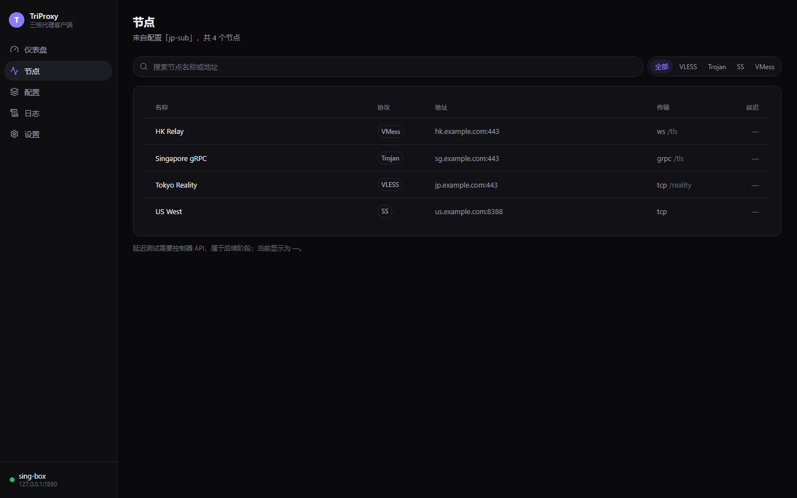

<!--
  TriProxy — a modern multi-core proxy client.
  Copyright (C) 2026 luoqingci
  SPDX-License-Identifier: GPL-3.0-or-later

  This program is free software: you can redistribute it and/or modify it under
  the terms of the GNU General Public License as published by the Free Software
  Foundation, either version 3 of the License, or (at your option) any later
  version. It is distributed in the hope that it will be useful, but WITHOUT ANY
  WARRANTY; without even the implied warranty of MERCHANTABILITY or FITNESS FOR A
  PARTICULAR PURPOSE. See LICENSE for the full text.

  Additional terms under GNU GPL v3 section 7 apply: see ADDITIONAL-TERMS.md.
-->

# TriProxy

一个用 Rust 写的代理客户端，统一管理 **Mihomo / sing-box / Xray** 三个核心。
你只需要「导入配置 → 选节点 → 连接」：协议识别、核心选择、配置转换、系统代理、TUN、DNS
全部由程序完成，三个核心的配置格式差异由编译器吸收。

桌面端常驻托盘，关窗口不断网。命令行与图形界面共用同一份数据和同一套逻辑——同一条命令
在两边做的事、给出的数字都一致。


> 产品规划见 [`docs/PROJECT_PLAN.md`](docs/PROJECT_PLAN.md)（**规划书，不是现状**）。
> 实现范围、取舍理由与已知边界见 [`docs/ARCHITECTURE.md`](docs/ARCHITECTURE.md)。

---

## 目录

- [安装](#安装)
- [快速开始](#快速开始)
- [桌面客户端](#桌面客户端)
- [命令行](#命令行)
- [协议与配置导入](#协议与配置导入)
- [配置编译与智能选核](#配置编译与智能选核)
- [网络模式](#网络模式)
- [分流](#分流)
- [订阅与代理组](#订阅与代理组)
- [观测：连接 / 流量 / 延迟 / 内存](#观测连接--流量--延迟--内存)
- [更新](#更新)
- [设计要点](#设计要点)
- [已知限制](#已知限制)
- [开发与测试](#开发与测试)
- [目录结构](#目录结构)
- [授权](#授权)

---

## 安装

### 发行包

每次发布由 GitHub Actions 构建两种包（[`.github/workflows/release.yml`](.github/workflows/release.yml)），
文件名读作「产品-版本-平台-架构-变体」，例如 `TriProxy-0.2.6-windows-x64-lite.exe`：

| 变体 | 内容 | 适用场景 |
|---|---|---|
| `-lite` | 图形界面 + 命令行，**不含核心** | 首次运行在界面里点「下载核心」，或自行管理核心版本 |
| `-full` | 同上 + `cores/` 内三个已校验核心 + 各核心许可全文 | 开箱即用，首次运行无需联网 |

`full` 版的核心由 CI 调用 TriProxy 自身的下载与校验流程获取，SHA256 与上游 Release 一致，
未经修改，并随包附带 `cores/THIRD-PARTY-NOTICES.txt`（版本、授权、对应源码地址）与
`cores/LICENSE-<core>.txt`（取自与二进制相同 tag 的许可全文）。

当前平台：Windows x86_64、Linux x86_64、macOS Apple Silicon。
macOS Intel 不在支持范围（Apple 已停售 Intel Mac），自行编译仍可用。

### 从源码

需要 Rust 1.82+；前端构建另需 Node。

```bash
git clone https://github.com/luoqingciya/TriProxy.git
cd TriProxy
cargo build --release            # CLI
npm install && npm run tauri build   # 桌面端
```

### 核心从哪里来

```text
环境变量 TRIPROXY_*_BIN  →  用户安装的 bin/（managed）  →  随包的 cores/（bundled）  →  PATH
```

`managed` 优先于 `bundled`：用 `triproxy core install` 更新过核心后，不会悄悄回落到随包的旧版本。
`triproxy core path <core>` 打印实际来源。

---

## 快速开始

### 图形界面

1. **配置** 页导入订阅（粘贴 URL 或分享链接，也可以直接点 `triproxy://` 链接）；
2. **节点** 页什么都不选就是「自动选择」，也可以点某个节点固定使用；
3. 回到 **仪表盘** 点「连接」。

关闭窗口只是收进托盘，核心继续跑。

### 命令行

```bash
triproxy core install mihomo          # lite 包需要；full 包可跳过
triproxy profile add ./sub.txt --use  # 导入并设为活动配置
triproxy start                        # 启动（默认用上次的核心）
triproxy status                       # 状态、端口、内存
triproxy delay                        # 当前节点的真实延迟
```

国内直连 GitHub Release 通常不可用，可以指定镜像或用本地已下载的压缩包：

```bash
triproxy core install mihomo --mirror https://ghfast.top/
triproxy core install xray --file ./Xray-windows-64.zip
```

GitHub API 未认证限流 60 次/小时（按 IP），设 `GITHUB_TOKEN` 或 `TRIPROXY_GITHUB_TOKEN` 可提到 5000。

---

## 桌面客户端



```bash
npm run tauri dev      # 开发模式（自动起 Vite + 桌面窗口）
npm run dev            # 只跑界面，使用假数据：http://localhost:1420
```

> **Windows 上桌面版始终以管理员身份运行**：TUN 需要创建虚拟网卡，没有管理员权限会在核心内部
> 失败并给出难懂的日志。清单里声明了 `requireAdministrator`，启动时由系统弹一次 UAC。

六个页面：

| 页面 | 内容 |
|---|---|
| 仪表盘 | 连接状态、真实延迟、核心内存、流量曲线（最近 3 分钟）、当前配置、三个核心的状态与一键切换、Smart Engine 决策解释 |
| 节点 | 活动配置的节点列表 + 顶部「自动选择」行；搜索、按协议筛选、收藏、点击即切换、TCP / 真实延迟测试 |
| 连接 | 每条连接的目标、进程、命中规则、链路、上下行，可单独关闭 |
| 配置 | 导入、设为活动、刷新订阅、删除 |
| 日志 | 核心输出实时刷新，按级别筛选，逐连接记录默认折叠 |
| 设置 | 见下 |

### 托盘、单实例、深链接

代理客户端关掉窗口就断网是说不通的，所以窗口只是面板，托盘才是它真正的家：

- 点关闭按钮 = 隐藏到托盘，核心继续跑，系统代理保持不动；
- 左键点图标 = 显示 / 收起窗口；右键出菜单：状态行 / 显示主窗口 / 启动·停止核心 / 退出；
- 状态行是只读的，写清在干什么：`Mihomo · 自动选择` 或 `未运行`。托盘常驻的应用，最不能
  接受的就是「图标看起来一样，但代理是开是关看不出来」；
- 「退出」才会真正结束进程，并且**先停核心、再还原系统代理**；
- 设置里关掉「关闭窗口时驻留托盘」就退回普通窗口行为；系统托盘不可用时（例如没有
  StatusNotifier 的 Linux 会话）关闭窗口按普通退出处理，不会出现「窗口没了但进程还在」。

托盘在 Windows 与 Linux（Ubuntu 26.10 Desktop，GNOME / StatusNotifier）上实测正常；
macOS 走同一套 Tauri 接口，未真机点验。

**单实例**：再次启动不会起第二个管理器去抢同一个端口，而是把参数转交给运行中的实例并显示窗口。

**深链接**：

```text
triproxy://install?url=https%3A%2F%2Fexample.com%2Fsub%3Ftoken%3Dabc
```

按域名命名，库为空时自动激活。应用没在运行时由系统拉起；已在运行时（包括缩在托盘里）由
单实例转发。只注册 `triproxy://`，不抢 `clash://`——装了 Clash 系客户端的机器上抢那个 scheme
是不礼貌的。

### 设置项

| 分组 | 项 |
|---|---|
| 通用 | 主题、核心偏好（自动 / 指定）、关闭窗口驻留托盘、开机自启、启动后自动连接 |
| 网络 | 系统代理、TUN 模式、原生 rule-set 偏好、代理组偏好、允许局域网、监听端口、代理绕过列表 |
| 规则 | 自定义规则、规则集订阅、分流模式、DNS 模式 |
| 高级 | 日志级别、数据目录、应用内存、配置备份 |
| 更新 | 应用版本与检查更新 |

几处值得单独说：

- **监听端口**：默认 7890，被占用时改这里，改完重启核心生效。
- **开机自启**：状态从操作系统读回来，不是从 `settings.json` 猜——用户手删注册项后，
  一个仍显示「开」的开关要等到下次重启才会露馅。Windows 上会弹一次 UAC（清单要求管理员权限），
  彻底的解法是改用计划任务，尚未做。
- **配置备份**：导出一个 JSON（设置 + 全部配置 + 当前活动项），导入时**合并**而不是覆盖。
- **应用内存**：承载界面的 Rust 进程的 RSS，不含 WebView 渲染进程（见[观测](#观测连接--流量--延迟--内存)）。

---

## 命令行

```bash
triproxy status [--json]        # 三个核心的状态、端口、回环握手、内存
triproxy cores [--json]         # 核心列表与二进制安装状态
triproxy start [core]           # 启动核心（省略则用上次的活动核心）
triproxy stop                   # 停止当前核心
triproxy restart                # 重启当前核心
triproxy switch <core>          # 停旧起新，输出可解释的切换步骤
triproxy logs [-n N] [--core X] [-f]
```

| 命令 | 说明 |
|---|---|
| `triproxy delay [--timeout S] [--json]` | 当前节点的**真实延迟**；测不到时退出码 1 |
| `triproxy connections [--json] [--close ID] [--close-all]` | 实时连接列表与关闭 |
| `triproxy traffic [--json]` | 读一次实时流量采样 |
| `triproxy node use <名称或 id 前缀>` / `current` / `clear` | 选节点、看选择、清除选择 |
| `triproxy proxy on [--endpoint E]` / `off` / `status` | 系统代理 |
| `triproxy tun status` | TUN 权限与残留网卡 |
| `triproxy doctor` | 环境自检：二进制可执行性、端口占用、数据目录可写 |

Profile 相关：

| 命令 | 说明 |
|---|---|
| `triproxy profile parse <file\|-> [--json]` | 解析订阅 / 分享链接，列出节点 |
| `triproxy profile check <file\|-> [--json]` | 校验并报告问题（有错误时退出码 1） |
| `triproxy profile compile <file\|-> --core X [-o PATH] [--check]` | 编译成核心配置，`--check` 交给核心校验 |
| `triproxy profile add <file\|-> [--name N] [--use]` | 导入到本地库（同名则更新） |
| `triproxy profile list` / `show <id\|name>` / `use` / `current` / `remove` | 库操作 |
| `triproxy profile test [--http] [--url U]` | TCP 握手延迟，或由核心发请求测真实延迟 |
| `triproxy profile refresh <id\|name> \| --all` | 刷新 URL 订阅 |
| `triproxy core install <core> [--version V] [--force] [--mirror P] [--file PATH]` | 下载、校验、安装核心 |
| `triproxy core update [core] [--all] [--check]` | 检查并安装核心更新 |
| `triproxy core select <file\|-> [--tun] [--json]` | 评估哪个核心最适合这份配置（Smart Engine） |
| `triproxy core path <core>` | 实际使用的二进制路径 |

启动与编译的开关：`--tun`、`--proxy`、`--dns <off|split|fakeip>`、`--rules <global|split>`。
**只覆盖真正传了的参数**——没传的沿用设置里的值。

全局参数：`--data-dir <DIR>`（等价于 `TRIPROXY_HOME`）、`--json`。

数据目录默认是「可执行文件旁边的 `data/`」（Windows 便携布局），不可写时回落到
`%APPDATA%\TriProxy` / `~/Library/Application Support/TriProxy` / `~/.local/share/TriProxy`。

---

## 协议与配置导入

支持分享链接列表、base64 订阅与 Clash YAML 三种输入，自动识别。

| 协议 | Mihomo | sing-box | Xray |
|---|:---:|:---:|:---:|
| Shadowsocks | ✓ | ✓ | ✓ |
| VMess | ✓ | ✓ | ✓ |
| VLESS（含 REALITY / Vision / xtls） | ✓ | ✓ | ✓ |
| Trojan | ✓ | ✓ | ✓ |
| Hysteria2 | ✓ | ✓ | — |
| TUIC | ✓ | ✓ | — |
| SOCKS5 出站 | ✓ | ✓ | ✓ |
| HTTP(S) 出站 | ✓ | ✓ | ✓ |

WireGuard 在能力矩阵里声明为「三个核心都支持」，但**还没有解析器**，所以目前解析不出这类节点。

```bash
triproxy profile parse ./sub.txt        # 列出解析出的节点
triproxy profile check ./sub.txt        # 只报告问题，有错误时退出码 1
curl -s "$SUB_URL" | triproxy profile parse - --json
```

单行解析失败不会中断整份订阅——它变成一条带行号的诊断，其余节点照常导入：

```text
  #  NAME       PROTOCOL     ENDPOINT             TRANSPORT  SECURITY
  1  Tokyo 01   vless        jp.example.com:443   ws         reality
  2  HK 01      vmess        hk.example.com:443   ws         tls
  3  Singapore  trojan       sg.example.com:443   grpc       tls
  4  US West    shadowsocks  us.example.com:8388  tcp        -

1 errors, 0 warnings
  error   line.unsupported_scheme     line 5: unsupported scheme `snell://`
```

节点身份由连接参数（协议、地址、端口、凭据、传输）派生，与显示名称无关：服务商改名不影响
收藏与延迟记录。

**Clash YAML 只取 `proxies:` 段**，`proxy-groups` 与 `rules` 忽略——本程序自己生成代理组和
分流规则。不支持的节点类型逐条报出来，不会悄悄丢掉。

---

## 配置编译与智能选核

同一份 Unified Profile 可以编译成三个核心各自的配置，并用核心自己校验：

```bash
triproxy profile compile ./sub.txt --core mihomo   -o config.yaml --check
triproxy profile compile ./sub.txt --core sing-box -o config.json --check
triproxy profile compile ./sub.txt --core xray     -o config.json --check

triproxy start mihomo --profile ./sub.txt --proxy
triproxy switch xray --profile ./sub.txt
```

两条原则：

- **无法忠实表达的节点会被跳过并说明原因**，不做近似。例如 Xray 的 REALITY 只支持 TCP/gRPC，
  于是 Reality over WebSocket 在 Xray 配置里被略过；mihomo 与 sing-box 接受该组合。
- **生成的配置先由核心校验**（`mihomo -t` / `sing-box check` / `xray -test`）。
  编译器有 bug 会表现为「配置被拒绝」，而不是「核心起来了但行为不对」。

智能选核：

```bash
triproxy core select ./sub.txt          # 评估三个核心，给出结论与理由
triproxy core select ./sub.txt --tun    # 把 TUN 作为硬需求（Xray 会被淘汰）
triproxy switch smart --profile ./sub.txt
```

排序采用字典序而非加权评分：**硬约束淘汰 → 原生特性数量 → 文档化的默认顺序**。
规划书里的 50/25/15/10 权重没有实现——兼容性一旦不满足就该出局（不是「90% 兼容」），
而性能权重背后没有任何测量数据。

```text
  CORE      VERDICT     DETAIL
  sing-box  selected    -
  mihomo    eligible    -
  xray      ineligible  missing TUN
```

---

## 网络模式

### 系统代理

```bash
triproxy start mihomo --proxy     # 启动并接管系统代理
triproxy proxy status
triproxy proxy off                # 还原 TriProxy 改动前的设置
```

启动与停止是联动的：`stop` 自动还原系统代理，`start --proxy` 在核心就绪后才改系统设置。

设计上只做一件事：**保证不留下烂摊子**。

- 改之前先把原值写入 `<data>/system-proxy.json`，崩溃后下一次启动自愈；
- 重复启用不会把「自己写的值」当成原始值，否则恢复等于没恢复；
- 核心没在监听时拒绝启用——把整台机器指向一个死端口比不改更糟。

**绕过列表可配**（设置 → 代理绕过列表，分号分隔）。留空等于用默认列表，而不是「什么都不绕过」：
把 localhost 也代理走会毁掉本机所有开发服务器。

Windows 已实测（含外部杀进程模拟崩溃后的自动恢复）；macOS 与 Linux 按同一接口实现，
未在真机验证。

### TUN

```bash
triproxy start mihomo --tun
triproxy tun status     # 权限、残留网卡
```

需要管理员权限。核心崩溃后网卡与路由会被清理，`tun status` 可以确认没有残留。

### DNS

```bash
triproxy start mihomo --tun --dns fakeip
triproxy start mihomo --dns split
```

| 模式 | 行为 |
|---|---|
| `off` | 不生成 `dns` 段（默认） |
| `split` | 被代理域名走隧道内解析，其余走本地 |
| `fakeip` | 被代理域名返回假 IP，真实域名在隧道内解析 |

打开 TUN 时 `off` 会自动提升为 `split`：没有 DNS 段与劫持规则，TUN 只是把发往原解析器的
UDP 包一起塞进隧道，既慢又不防泄漏。

**防泄漏的做法是让查询本身走隧道**——mihomo 的 nameserver 带 `#PROXY` 后缀，sing-box 的
dns server 带 `detour: PROXY` 并启用 `hijack-dns`。只把系统 DNS 换成公共解析器不算防泄漏：
查询照样从本地网络发出，只是换了个观察者。

因此**没有实现修改系统 DNS**：有 TUN 时它多余，没有 TUN 时它无效，而核心异常退出会让整台
机器 DNS 全挂。理由见 ARCHITECTURE 第 13.3 节。

---

## 分流

| 模式 | 行为 |
|---|---|
| `global` | 全部走代理（默认） |
| `split` | 局域网 + 国内目标直连，其余走代理 |

三个核心的实现方式完全不同：mihomo 用内置 `GEOSITE`/`GEOIP`，Xray 用自带的
`geosite.dat`/`geoip.dat`，sing-box 1.12 之后只能靠**远程 rule-set**（运行时下载）。

### 自定义规则

设置 → 自定义规则，一行一条，Clash 语法：

```text
# 公司内网域名绝不走代理
DOMAIN-SUFFIX,corp.internal,DIRECT
DOMAIN-KEYWORD,telemetry,PROXY
IP-CIDR,10.0.0.0/8,DIRECT,no-resolve
```

- 支持 `DOMAIN` / `DOMAIN-SUFFIX` / `DOMAIN-KEYWORD` / `IP-CIDR`，目标写 `PROXY` 或 `DIRECT`；
- **按顺序匹配，自定义规则排在预设之前**：`DOMAIN-SUFFIX,cn,PROXY` 能压过 split 的
  `GEOSITE,cn,DIRECT`；
- 保存时校验，错误带行号；解析失败的规则不会让整个连接起不来（会被丢弃并记日志）。

同一个解析器喂给三个编译器，各渲染成自己的方言。细节见 ARCHITECTURE 第 23 章。

### 规则集订阅

一行一条，`目标,类型,URL`：

```text
DIRECT,domain,https://example.com/rules/cn.mrs
PROXY,ipcidr,https://example.com/rules/remote.srs
```

两个核心的规则集格式不通用：`.mrs`/`.yaml` 只对 Mihomo 生效，`.srs` 只对 sing-box 生效，
**Xray 不支持规则集**。类型（`domain` / `ipcidr` / `classical`）必须写明——Mihomo 要求声明
`behavior`，猜错就是一份它拒绝加载的配置。

---

## 订阅与代理组

```bash
triproxy profile add https://example.com/sub --name jp-sub --use   # URL 即订阅
triproxy profile refresh jp-sub      # 手动刷新（304 时不做无谓重解析）
triproxy profile refresh --all       # 刷新全部到期的
```

- **缓存走条件请求**：`ETag` / `Last-Modified` 随订阅存盘，下次带 `If-None-Match`，304 就跳过。
- **刷新失败不毁数据**：只记录 `last_error`，已存节点原样保留，退出码 1。
- **桌面端自动刷新**：进程活着就有一个 1 分钟的 ticker，按每个订阅自己的 interval 判断到期；
  单个源失败不会停表。CLI 只在你显式调用时刷新。

编译结果里有两个组：

```text
AUTO   url-test，每 5 分钟重测，取延迟最低
PROXY  select：[选中的节点?] AUTO 节点… DIRECT
```

**没选过节点 = 自动选择**，而不是「配置里排第一的那个」。节点页顶部那行「自动选择」就是它；
点任意节点会排到 AUTO 前面，成为默认。

Mihomo 与 sing-box 支持运行时切换（点一下立刻生效）；Xray 没有控制器 API，选择保存、下次
启动生效。

---

## 观测：连接 / 流量 / 延迟 / 内存

### 前提

连接、流量、真实延迟、运行时切换节点都依赖核心的 **Clash 兼容控制器 API**，Mihomo 与 sing-box
都有，**Xray 没有**。界面上会说明原因，而不是显示空面板。

### 三个「延迟」，不要互相冒充

| 指标 | 做法 | 证明什么 | 出现在 |
|---|---|---|---|
| 回环握手 | 连本地入站端口 | 端口在监听 | `triproxy status` 的 `LOOPBACK` 列（`<1 ms`） |
| TCP 延迟 | 连节点 `server:port` | 端点可达、有多远 | 节点页「TCP 延迟」、`profile test` |
| 真实延迟 | 核心通过节点发 HTTP 请求 | **代理真的能用** | 仪表盘、`triproxy delay`、节点页「真实延迟」 |

凭据错、UUID 过期、加密不匹配——TCP 握手全都会成功，真实延迟全都会失败。所以三个都要有，
且分别命名。

仪表盘那行摘要显示的是**真实延迟**：每 15 秒由核心发一次请求穿过当前节点。不可用时显示
`延迟 —`，鼠标悬停能看到原因（Xray 没有控制器 API、核心还没选定节点、探测失败）。

> 早先这里显示的是回环握手的结果，恒为 `0 ms`，看上去永远「秒连」。这个数字已经删掉了。

### 内存

显示的是 **RSS**（常驻集大小），也就是任务管理器 / 活动监视器里那一列，不是虚拟大小。

| 位置 | 是什么 |
|---|---|
| 仪表盘摘要、核心表 | 核心进程的 RSS（只有运行中的那个有值） |
| 设置 → 应用内存 | 承载界面的 Rust 进程的 RSS，不含 WebView 渲染进程 |

不缓存：核心的占用随连接数和加载的规则数据变化，缓存下来等于永远显示启动那一刻的数字。

### 连接与流量

```bash
triproxy connections                 # 实时连接列表
triproxy connections --close-all     # 全部关闭
triproxy traffic                     # 读一次流量采样
```

连接列表每条都带**进程**和**命中规则**：前者来自核心的 `metadata.process`（Mihomo 给进程名，
sing-box 给完整路径），后者是 `rule` + `rulePayload`。排查「这个站为什么走了直连」时，
这两个字段比流量数字有用得多。

仪表盘画最近 3 分钟的上下行曲线（内存里保留 90 个采样，不落盘——它回答的是「刚才网络在干什么」，
落盘就要设计 schema、保留策略和一个可能损坏的文件）。

---

## 更新

```bash
triproxy core update --check     # 只看有没有新版
triproxy core update --all       # 安装全部更新
```

应用自身在设置页「检查更新」。更新包只发布 `lite` 变体（更小），`latest.json` 带三个平台的
签名，签名校验失败会拒绝安装。

---

## 设计要点

**独占性**：任何时刻最多一个核心处于 `Running`。`start` 遇到别的核心在跑时直接拒绝并提示改用
`switch`，避免多个核心抢端口、抢 TUN、抢系统代理。

**状态机**：`Stopped → Starting → Running → Stopping → Stopped`，异常进入 `Failed`。
只有终态允许启动。

**跨进程接管**：CLI 每次调用是独立进程，而核心必须常驻。管理器把 `pid` 持久化到 `state.json`，
下次调用接管仍在运行的进程并改用 PID 探活；PID 已消失则清理陈旧状态。

**校验和不妥协**：二进制从官方 Release 下载，SHA256 取自 `api.github.com` 的 asset digest
（回退 `.dgst` / `checksums.txt`），取不到校验和则拒绝安装（除非显式 `--allow-unverified`）。
镜像只能造成失败，无法投毒。

**日志跨调用可见**：内存环形缓冲随进程消失，所以核心输出同时落到 `logs/<core>.log`。

**随包核心只读**：`cores/` 由发行包提供，运行时从不写入；安装与更新都进 `bin/`。

**路径一律绝对**：`Layout` 在构造时把相对路径锚定到工作目录。核心是用
`-f <config> -d <config 所在目录>` 启动的，相对 `-f` 会被 `-d` 重新解释，配置找不到时核心
会安静地用默认配置继续跑——不报错，只是什么都没生效。

---

## 已知限制

| 限制 | 说明 |
|---|---|
| 协议 | 缺 WireGuard、SSH、SSR、Snell、AnyTLS。这一组必须有真实服务端才能验证，映射写错不会报错、只会行为不同 |
| 规则集 | 格式按核心分流：`.mrs`/`.yaml` 归 Mihomo，`.srs` 归 sing-box，Xray 不支持 |
| 节点管理 | 能搜索、按协议过滤、收藏；没有分组和手动排序 |
| 流量历史 | 只有 3 分钟，不落盘 |
| 多语言 | 界面只有中文 |
| 平台验证 | Windows 与 Linux（Ubuntu 26.10 Desktop）实测可用，托盘正常；macOS 仍未经真机验证；系统代理与深链接只在 Windows 上核对过 |
| 开机自启 | Windows 走 Run 键，登录时会弹一次 UAC；计划任务方案未做 |
| 应用更新 | 只在包含该功能的版本之后生效 |

---

## 开发与测试

```bash
cargo test --workspace                       # 259 个单元测试（core + CLI）
cargo clippy --workspace --all-targets -- -D warnings
cargo fmt --all -- --check
npx tsc --noEmit && npm run build            # 前端
cd src-tauri && cargo test                   # 外壳的纯逻辑测试（备份、深链接）
```

编译器的测试只断言生成的文本 / JSON 结构；**真实配置的正确性靠核心自己校验**——
`mihomo -t` / `sing-box check` / `xray -test` 在每次启动前都会跑一遍。

手动验证一份配置：

```bash
triproxy core install mihomo          # 需要 GITHUB_TOKEN，否则 API 限流
triproxy start mihomo --profile ./sub.txt > /tmp/start.log 2>&1
curl -s http://127.0.0.1:9090/proxies  # 运行时分组
triproxy delay                         # 真实延迟
triproxy stop
```

两个坑，都踩过：

- **`start` 的输出不要接管道**：核心进程会继承 stdout 并一直持有它，`tail` 等不到 EOF。
- **验证要看运行时行为，不只看「配置被接受」**：SOCKS5 出站是这样验的——sing-box 起一个带认证的
  socks 入站当目标，mihomo 加载它，`curl -x` 得到 200；**杀掉那个入站后同一请求变 502**。
  502 那一步才证明链路真的经过它，因为只看到 200 分不清「链路通了」和「核心悄悄直连了」。

---

## 目录结构

```text
TriProxy/
├── crates/
│   ├── triproxy-core/          # UI 无关的核心层（Tauri 后端与 CLI 共用）
│   │   └── src/
│   │       ├── core/           # CoreKind / ProxyCore trait / CoreManager
│   │       ├── profile/        # Unified Profile：节点模型、URI 解析、校验
│   │       ├── compiler/       # 配置编译器：Profile → 三个核心的原生配置
│   │       │   └── rules.rs    # 自定义规则与规则集的唯一解析器（三方言共用）
│   │       ├── adapters/       # mihomo / singbox / xray 三个方言
│   │       ├── binaries/       # 定位、下载、校验、解包
│   │       ├── controller.rs   # Clash 兼容控制器 API（连接 / 流量 / 延迟 / 切换）
│   │       ├── latency.rs      # TCP 握手、真实延迟、当前节点延迟
│   │       ├── memory.rs       # 进程 RSS
│   │       ├── process.rs      # 进程监督器（启动 / 就绪探测 / 停止 / 日志捕获）
│   │       ├── bootstrap.rs    # 最小配置（非 Config Compiler）
│   │       ├── capability.rs   # 能力矩阵（Smart Engine 的输入）
│   │       ├── paths.rs        # 数据目录布局
│   │       └── state.rs        # 核心状态机
│   └── triproxy-cli/           # triproxy 命令行
├── src/                        # React 前端（仪表盘 / 节点 / 连接 / 配置 / 日志 / 设置）
├── src-tauri/                  # 桌面外壳
│   └── src/
│       ├── commands.rs         # 前端可调用的命令（业务逻辑仍在 core）
│       ├── tray.rs             # 托盘图标、菜单、退出路径
│       ├── deep_link.rs        # triproxy:// 链接
│       ├── backup.rs           # 配置备份与恢复
│       └── lib.rs              # 组装：插件、调度器、退出清理
└── docs/
    ├── PROJECT_PLAN.md
    └── ARCHITECTURE.md
```

`triproxy-core` 不依赖任何 UI 技术，Tauri 后端与 CLI 只是它的两个壳。

---

## 授权

本项目以 **GNU General Public License v3.0 或更新版本**（GPL-3.0-or-later）发布，
全文见 [`LICENSE`](LICENSE)。

依据 GPLv3 第 7 条附加以下条款（详见 [`ADDITIONAL-TERMS.md`](ADDITIONAL-TERMS.md)）：

1. **保留声明**：任何分发（源码或二进制、修改与否）须完整保留版权声明、GPLv3 许可声明、
   SPDX 标识与第三方组件归属声明，不得删除或遮蔽。
2. **修改版须改名**：分发修改版须使用与 "TriProxy" 明显不同的名称，不得以本项目名称、
   标识、图标作为修改版的名称或品牌，并须明确标注该版本已被修改及修改者。
3. **不得暗示背书**：未经书面许可，不得声称或暗示原版作者对您的分发版本提供背书或存在关联。

每个源文件头部均带版权与 SPDX 声明；`triproxy --version` 输出包含版权、许可与无担保声明。

三个核心二进制是独立作品，适用各自授权（Mihomo GPL-3.0、sing-box GPL-3.0-or-later、
Xray MPL-2.0），来源与合规说明见 [`NOTICE.md`](NOTICE.md)。

Copyright © 2026 luoqingci
