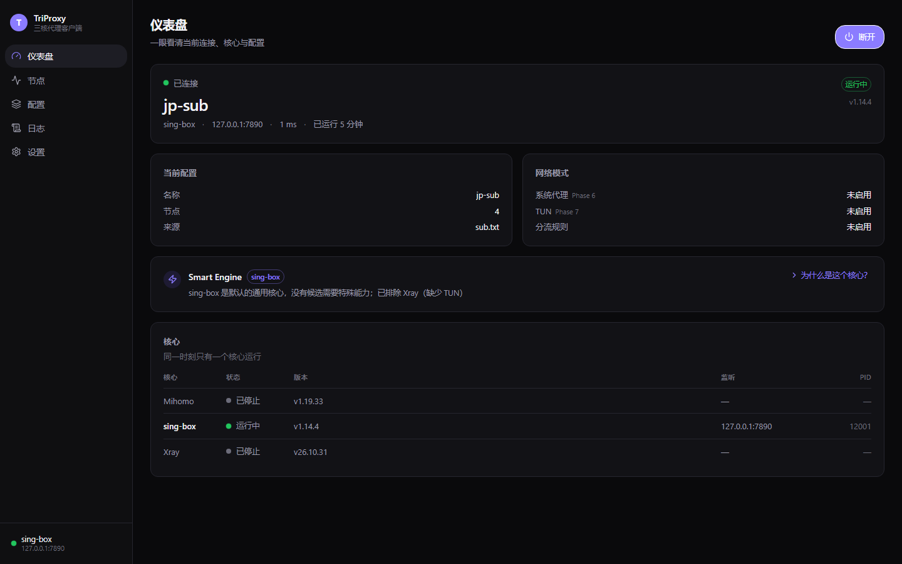

<!--
  TriProxy — a modern multi-core proxy client.
  Copyright (C) 2026 luoqingci
  SPDX-License-Identifier: GPL-3.0-or-later

  This program is free software: you can redistribute it and/or modify it under
  the terms of the GNU General Public License as published by the Free Software
  Foundation, either version 3 of the License, or (at your option) any later
  version. It is distributed in the hope that it will be useful, but WITHOUT ANY
  WARRANTY; without even the implied warranty of MERCHANTABILITY or FITNESS FOR A
  PARTICULAR PURPOSE. See LICENSE for the full text.

  Additional terms under GNU GPL v3 section 7 apply: see ADDITIONAL-TERMS.md.
-->

# TriProxy

一个基于 Rust 的现代化代理客户端，统一管理 **Mihomo / sing-box / Xray** 三个核心。
用户只需要「导入配置 → 选择节点 → 连接」，配置解析、协议识别、核心选择、配置转换、网络管理全部由程序完成。

> 完整产品规划见 [`docs/PROJECT_PLAN.md`](docs/PROJECT_PLAN.md)。
> 当前实现范围见 [`docs/ARCHITECTURE.md`](docs/ARCHITECTURE.md)。

---

## 当前进度

| 阶段 | 内容 | 状态 |
|---|---|---|
| Phase 0 | 产品与架构设计 | 已完成（规划书） |
| **Phase 1** | **Rust 多核心管理器 MVP + CLI** | **已完成并通过三核心真机验证** |
| **Phase 2** | **Unified Profile / Parser / Validator** | **已完成（VLESS / VMess / Trojan / Shadowsocks）** |
| **Phase 3** | **Config Compiler** | **已完成（三核心配置均通过各自核心校验）** |
| **Phase 4** | **Smart Core Selector** | **已完成（硬约束淘汰 + 可解释排序）** |
| **Phase 5** | **Tauri GUI** | **已完成（仪表盘 / 节点 / 配置 / 日志 / 设置）** |
| **Phase 6** | **系统代理** | **已完成（Windows 实测，macOS/Linux 待验证）** |
| **Phase 7** | **TUN 模式** | **已完成（管理员实测：网卡与路由在崩溃后均被清理）** |
| **Phase 8** | **DNS** | **已完成（三核心 × 三模式全部通过校验；未改系统 DNS，理由见文档）** |
| **Phase 9** | **订阅** | **已完成（URL 导入 / 条件请求缓存 / 错误恢复；无后台定时器）** |

Phase 1 的验收目标（规划书第 39 章）已全部达成：

```text
triproxy start mihomo      ✓
triproxy stop              ✓
triproxy start sing-box    ✓
triproxy switch xray       ✓
triproxy status            ✓
```

三个核心均可稳定 启动 / 停止 / 重启 / 切换 / 读取日志 / 检查状态。

---

## 快速开始

需要 Rust 1.82+ 与 Node 仅在前端阶段才需要。

```bash
git clone https://github.com/luoqingciya/TriProxy.git
cd TriProxy
cargo build --release
```

首次使用需要核心二进制。`lite` 版不含核心，需下载（校验和来源见 [`NOTICE.md`](NOTICE.md)）；
`full` 版已随包附带，可跳过此步：

```bash
triproxy core install mihomo
triproxy core install sing-box
triproxy core install xray
```

国内网络直连 GitHub Release 通常不可用，可指定镜像或使用本地已下载的压缩包：

```bash
triproxy core install mihomo --mirror https://ghfast.top/
triproxy core install xray --file ./Xray-windows-64.zip
```

若遇到 GitHub API 限流（未认证为 60 次/小时，按 IP 计），设置 `GITHUB_TOKEN` 或
`TRIPROXY_GITHUB_TOKEN` 即可提升到 5000 次/小时。

然后：

```bash
triproxy status            # 三个核心的状态一览
triproxy start sing-box    # 启动指定核心
triproxy switch xray       # 切换到另一个核心（自动停旧起新）
triproxy logs -f           # 跟踪日志
```

---

## 两种发行包

每次发布由 GitHub Actions 构建两种压缩包（见 [`.github/workflows/release.yml`](.github/workflows/release.yml)）：

| 包 | 内容 | 适用场景 |
|---|---|---|
| `triproxy-<target>-lite` | 仅可执行文件 | 想自行管理核心版本、或需自行指定镜像/代理下载 |
| `triproxy-<target>-full` | 可执行文件 + `cores/` 内三个已校验核心 + 各核心许可全文 | 开箱即用，首次运行无需联网 |

`full` 版的核心由 CI 调用 TriProxy 自身的下载与校验流程获取，SHA256 与上游 Release 一致，
未经修改，并随包附带 `cores/THIRD-PARTY-NOTICES.txt`（版本、授权、对应源码地址）与
`cores/LICENSE-<core>.txt`（取自与二进制相同的 tag 的许可全文）。两种包都包含 TriProxy
自身的 `LICENSE` 与 `ADDITIONAL-TERMS.md`。

当前发布的平台：Windows x86_64、Linux x86_64、macOS Apple Silicon。
macOS Intel 不在支持范围（Apple 已停售 Intel Mac），但自行编译仍可用。

核心解析顺序（`triproxy core path <core>` 可查看实际来源）：

```text
环境变量 TRIPROXY_*_BIN  →  用户安装的 bin/（managed）  →  随包的 cores/（bundled）  →  PATH
```

`managed` 优先于 `bundled`，因此用户用 `triproxy core install` 更新过核心后，
不会悄悄回落到随包的旧版本。

## 命令

| 命令 | 说明 |
|---|---|
| `triproxy status [--json]` | 管理器状态：活动核心、各核心状态/端口/延迟/二进制 |
| `triproxy cores [--json]` | 核心列表与二进制安装状态 |
| `triproxy start [core]` | 启动核心（省略则用上次的活动核心） |
| `triproxy stop` | 停止当前核心 |
| `triproxy restart` | 重启当前核心 |
| `triproxy switch <core>` | 停旧起新，输出可解释的切换步骤 |
| `triproxy logs [-n N] [--core X] [-f]` | 查看/跟踪核心日志 |
| `triproxy profile parse <file\|-> [--json]` | 解析订阅/分享链接，列出节点 |
| `triproxy profile compile <file\|-> --core X [-o PATH] [--check]` | 编译成核心配置；`--check` 交给核心校验 |
| `triproxy profile check <file\|-> [--json]` | 校验并报告问题（有错误时退出码 1） |
| `triproxy profile add <file\|-> [--name N] [--use]` | 导入到本地库（同名则更新） |
| `triproxy profile list [--json]` | 列出已存 Profile |
| `triproxy profile show <id\|name> [--json]` | 查看某个 Profile 的节点 |
| `triproxy profile use <id\|name>` | 设为活动 Profile |
| `triproxy profile current [--json]` | 查看活动 Profile |
| `triproxy profile remove <id\|name>` | 删除 |
| `triproxy core install <core> [--version V] [--force] [--mirror P] [--file PATH]` | 下载、校验、安装核心 |
| `triproxy core path <core>` | 打印实际使用的二进制路径 |
| `triproxy core select <file\|-> [--tun] [--json]` | 评估哪个核心最适合这份 Profile（Smart Engine） |
| `triproxy proxy on [--endpoint E]` | 把系统代理指向当前核心 |
| `triproxy proxy off` | 还原 TriProxy 改动前的系统代理设置 |
| `triproxy proxy status` | 查看系统代理是否由 TriProxy 托管 |
| `triproxy tun status` | 查看 TUN 权限与残留网卡 |
| `--dns <off\|split\|fakeip>` | start / switch / profile compile 的 DNS 模式 |
| `triproxy doctor` | 环境自检：二进制可执行性、端口占用、数据目录可写 |

全局参数：`--data-dir <DIR>`（等价于环境变量 `TRIPROXY_HOME`）、`--json`。

数据目录默认为 `%APPDATA%\TriProxy`（Windows）/ `~/Library/Application Support/TriProxy`（macOS）/ `~/.local/share/TriProxy`（Linux）。

## 配置导入（Phase 2）

支持分享链接列表与 base64 订阅（服务商最常见的两种下发方式），协议覆盖 VLESS / VMess / Trojan / Shadowsocks：

```bash
triproxy profile parse ./sub.txt        # 列出解析出的节点
triproxy profile check ./sub.txt        # 只报告问题，有错误时退出码 1
curl -s "$SUB_URL" | triproxy profile parse - --json
```

单行解析失败不会中断整份订阅——它变成一条带行号的诊断，其余节点照常导入：

```text
  #  NAME       PROTOCOL     ENDPOINT             TRANSPORT  SECURITY
  1  Tokyo 01   vless        jp.example.com:443   ws         reality
  2  HK 01      vmess        hk.example.com:443   ws         tls
  3  Singapore  trojan       sg.example.com:443   grpc       tls
  4  US West    shadowsocks  us.example.com:8388  tcp        -

1 errors, 0 warnings
  error   line.unsupported_scheme     line 5: unsupported scheme `hysteria2://`
```

节点身份由连接参数（协议、地址、端口、凭据、传输）派生，与显示名称无关，
因此服务商改名不会影响收藏与延迟记录。解析结果只是中间产物，真正的配置生成属于 Phase 3。

## 配置编译（Phase 3）

同一份 Unified Profile 可以编译成三个核心各自的配置，并用核心自己校验：

```bash
triproxy profile compile ./sub.txt --core mihomo   -o config.yaml --check
triproxy profile compile ./sub.txt --core sing-box -o config.json --check
triproxy profile compile ./sub.txt --core xray     -o config.json --check
```

也可以直接带着 Profile 启动或切换核心：

```bash
triproxy start mihomo --profile ./sub.txt --proxy
triproxy switch xray --profile ./sub.txt
```

编译的两条原则：

- **无法忠实表达的节点会被跳过并说明原因**，不做近似。例如 Xray 的 REALITY 只支持 TCP/gRPC，
  于是 Reality over WebSocket 的节点在 Xray 配置里会被略过；mihomo 与 sing-box 则接受该组合。
- **生成的配置先由核心校验**（`mihomo -t` / `sing-box check` / `xray -test`），
  编译器有 bug 会表现为「配置被拒绝」，而不是「核心起来了但行为不对」。

## 智能选核（Phase 4）

```bash
triproxy core select ./sub.txt          # 评估三个核心，给出结论与理由
triproxy core select ./sub.txt --tun    # 把 TUN 作为硬需求（Xray 会被淘汰）
triproxy switch smart --profile ./sub.txt
```

## 系统代理（Phase 6）

```bash
triproxy start mihomo --proxy     # 启动并接管系统代理
triproxy proxy status             # 查看当前指向
triproxy proxy off                # 还原 TriProxy 改动前的设置
```

启动与停止是联动的：`stop` 会自动还原系统代理，`start --proxy` 会在核心就绪后再改系统设置。

设计上只做一件事：**保证不留下烂摊子**。

- 改系统代理之前先把原值写入 `<data>/system-proxy.json`，崩溃后下一次启动会自愈；
- 重复启用不会把「自己写的值」当成原始值，否则恢复等于没恢复；
- 核心没在监听时拒绝启用——把整台机器指向一个死端口比不改更糟。

Windows 已实测（含外部杀进程模拟崩溃后的自动恢复）；macOS 与 Linux 按同一接口实现，
但尚未在真机验证。

## Profile 库

导入一次，之后 `start` / `switch` 直接使用活动 Profile，不必每次带 `--profile`：

```bash
triproxy profile add ./sub.txt --name jp-sub --use
triproxy profile list
triproxy start mihomo      # 用活动 Profile 编译后启动
triproxy switch smart      # 用活动 Profile + 智能选核
```

解析优先级：`--profile <file>` → 活动 Profile → 无 Profile 时退回 Phase 1 的直连最小配置。

排序采用字典序而非加权评分：**硬约束淘汰 → 原生特性数量 → 文档化的默认顺序**。
规划书里的 50/25/15/10 权重没有实现——兼容性一旦不满足就该出局（不是"90% 兼容"），
而性能权重背后没有任何测量数据。详细理由见 [`docs/ARCHITECTURE.md`](docs/ARCHITECTURE.md) 第 8 章。

```text
  CORE      VERDICT     DETAIL
  sing-box  selected    -
  mihomo    eligible    -
  xray      ineligible  missing TUN

Reason: sing-box is the default general-purpose core; no candidate needed a
specialisation; eliminated: xray (TUN)
```

---

## 设计要点

**独占性**：任何时刻最多一个核心处于 `Running`。`start` 遇到其他核心在运行时直接拒绝并提示改用 `switch`，避免多个核心同时抢端口、抢 TUN、抢系统代理。

**状态机**：`Stopped → Starting → Running → Stopping → Stopped`，异常进入 `Failed`。只有终态允许启动。

**跨进程接管**：CLI 每次调用是独立进程，而核心进程必须常驻。管理器把 `pid` 持久化到 `state.json`，下次调用时接管仍在运行的进程，并改用 PID 探活；PID 已消失则清理陈旧状态。这是 CLI 形态必需的，GUI 单进程形态下自然退化为普通句柄管理。

**校验和不妥协**：二进制从官方 Release 下载，SHA256 取自 `api.github.com` 的 asset digest（回退 `.dgst` / `checksums.txt`），取不到校验和则拒绝安装（除非显式 `--allow-unverified`）。因此镜像只能造成失败，无法投毒。

**日志跨调用可见**：内存环形缓冲随进程消失，所以核心输出同时落到 `logs/<core>.log`，`triproxy logs` 读文件、`-f` 轮询追加。

**随包核心只读**：`cores/` 目录由发行包提供，程序运行时从不写入；所有安装与更新都进 `bin/`。

---

## 订阅（Phase 9）

```bash
triproxy profile add https://example.com/sub --name jp-sub --use   # URL 即订阅
triproxy profile refresh jp-sub      # 手动刷新（304 时不做无谓重解析）
triproxy profile refresh --all       # 刷新全部
```

- **缓存走条件请求**：`ETag` / `Last-Modified` 随订阅存盘，下次带 `If-None-Match`，服务端回 304 就跳过。
- **刷新失败不毁数据**：只记录 `last_error`，已存的节点原样保留，退出码为 1。
- **自动更新只在显式调用时发生**（`--interval` 记录到期时间，`refresh --all` 只刷到期的）。没有后台常驻定时器。

## DNS（Phase 8）

```bash
triproxy start mihomo --tun --dns fakeip     # TUN + 假 IP，解析最快
triproxy start mihomo --dns split            # 只让被代理的域名走隧道内解析
triproxy profile compile sub.txt --core sing-box --dns split --check
```

| 模式 | 行为 |
|---|---|
| `off` | 不生成 `dns` 段（默认） |
| `split` | 被代理域名走隧道内解析，其余走本地 |
| `fakeip` | 被代理域名返回假 IP，真实域名在隧道内解析 |

打开 TUN 时 `off` 会自动提升为 `split`：没有 DNS 段与劫持规则，TUN 只是把发往原解析器的
UDP 包一起塞进隧道，既慢又不防泄漏。

**防泄漏的做法是让查询本身走隧道**——mihomo 的 nameserver 带 `#PROXY` 后缀，
sing-box 的 dns server 带 `detour: PROXY` 并启用 `hijack-dns`。
只把系统 DNS 换成公共解析器不算防泄漏：查询照样从本地网络发出，只是换了个观察者。

因此**没有实现修改系统 DNS**（规划书 Phase 8 的 "Restore System DNS"）。理由写在
[`docs/ARCHITECTURE.md`](docs/ARCHITECTURE.md) 第 13.3 节：有 TUN 时它多余，没有 TUN 时它无效，
而一旦核心异常退出会让整台机器 DNS 全挂。

## 桌面客户端（Phase 5）



```bash
npm install
npm run tauri dev        # 开发模式（自动启动 Vite + 桌面窗口）
npm run tauri build      # 产出安装包
```

> **Windows 上桌面版始终以管理员身份运行**：TUN 模式需要创建虚拟网卡，没有管理员权限会在核心内部失败并给出难懂的日志。清单里声明了 `requireAdministrator`，启动时由系统弹出一次 UAC。

也可以在浏览器里只跑界面（无后端，使用假数据）：

```bash
npm run dev              # http://localhost:1420
```

界面包含五个页面：

| 页面 | 内容 |
|---|---|
| 仪表盘 | 连接状态、当前配置、三个核心的状态与一键切换、Smart Engine 决策解释 |
| 节点 | 活动配置的节点列表，按名称/地址搜索、按协议筛选 |
| 配置 | 导入订阅、设为活动、删除 |
| 日志 | 核心输出实时刷新，按级别筛选 |
| 设置 | 主题、核心偏好、TUN / rule-set / 代理组、允许局域网、日志级别 |

规则与连接两个页面依赖 Phase 10 的后端能力，暂不提供——留空页面比放一个假页面更糟。

## 目录结构

```text
TriProxy/
├── crates/
│   ├── triproxy-core/          # UI 无关的核心层（未来被 Tauri 后端复用）
│   │   └── src/
│   │       ├── core/           # CoreKind / ProxyCore trait / CoreManager
│   │       ├── profile/        # Unified Profile：节点模型、URI 解析、校验
│   │       ├── compiler/       # 配置编译器：Profile → 三个核心的原生配置
│   │       ├── adapters/       # mihomo / singbox / xray 三个方言
│   │       ├── binaries/       # 定位、下载、校验、解包
│   │       ├── process.rs      # 进程监督器（启动/就绪探测/停止/日志捕获）
│   │       ├── bootstrap.rs    # Phase 1 最小配置（非 Config Compiler）
│   │       ├── capability.rs   # 能力矩阵（Phase 4 的输入）
│   │       ├── logging.rs      # 环形缓冲 + 广播
│   │       ├── paths.rs        # 数据目录布局
│   │       └── state.rs        # 核心状态机
│   └── triproxy-cli/           # triproxy 命令行
└── docs/
    ├── PROJECT_PLAN.md
    └── ARCHITECTURE.md
```

`triproxy-core` 不依赖任何 UI 技术，Tauri 后端（Phase 5）只需把它作为依赖引入即可，无需重写业务逻辑。

---

## 测试

```bash
cargo test              # 46 个单元测试
cargo clippy --all-targets
```

---

## 授权

本项目以 **GNU General Public License v3.0 或更新版本**（GPL-3.0-or-later）发布，
全文见 [`LICENSE`](LICENSE)。

依据 GPLv3 第 7 条附加以下条款（详见 [`ADDITIONAL-TERMS.md`](ADDITIONAL-TERMS.md)）：

1. **保留声明**：任何分发（源码或二进制、修改与否）须完整保留版权声明、GPLv3 许可声明、
   SPDX 标识与第三方组件归属声明，不得删除或遮蔽。
2. **修改版须改名**：分发修改版须使用与 "TriProxy" 明显不同的名称，不得以本项目名称、
   标识、图标作为修改版的名称或品牌，并须明确标注该版本已被修改及修改者。
3. **不得暗示背书**：未经书面许可，不得声称或暗示原版作者对您的分发版本提供背书或存在关联。

每个源文件头部均带版权与 SPDX 声明；`triproxy --version` 输出包含版权、许可与无担保声明。
`LICENSE` 为 GPLv3 全文，"How to Apply" 附录中的模板字段已填入本项目信息。

三个核心二进制是独立作品，适用各自授权（Mihomo GPL-3.0、sing-box GPL-3.0-or-later、
Xray MPL-2.0），来源与合规说明见 [`NOTICE.md`](NOTICE.md)。

Copyright © 2026 luoqingci
